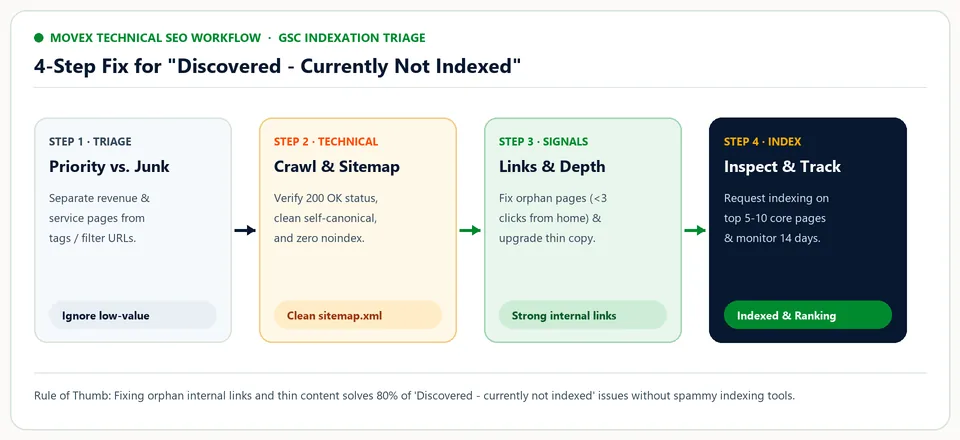

+++
title = "How to Fix 'Discovered – Currently Not Indexed' in Google Search Console"
slug = "discovered-currently-not-indexed-fix-checklist"
author = "Tariq — Technical SEO Specialist"
date = "2026-11-27"
modified = "2026-11-27"
description = "A practical 4-step triage checklist to diagnose and fix 'Discovered – currently not indexed' pages in Google Search Console for service and small business websites."
excerpt = "Learn why Google discovers URLs without crawling them, how to separate priority pages from junk URLs, and how internal links and content upgrades unlock indexation."
category = "Technical SEO & Indexation"
topic = "search"
read_minutes = 7
image = "assets/blog/discovered-not-indexed-cover.webp"
image_alt = "MoveX Technical SEO editorial cover for fixing Discovered Currently Not Indexed in Google Search Console"
tags = ["Technical SEO", "Google Search Console", "Indexation", "Crawl Budget", "Internal Linking"]
status = "published"
+++

You publish five new service pages or blog guides, check Google Search Console two weeks later, and find them sitting quietly under **Discovered – currently not indexed**.

Before you panic or pay for a sketchy "instant indexing" service, understand what that label actually means. Google has **not** penalized your website. It found your URL—usually through your XML sitemap or an external mention—and put it in a waiting queue because it has not decided the page is worth crawling yet.

> **Key diagnostic takeaway:** On newer or smaller business sites, "Discovered – currently not indexed" is almost always a **priority and value signal problem**, not a hidden penalty. Fix how easy the page is to reach and how useful it is before clicking Request Indexing.

## The 4-step triage workflow before you touch a single URL

Instead of blindly resubmitting every URL in Google Search Console, run this four-step triage sequence so you spend effort only on pages that actually bring leads or organic traffic.

## Step 1: Separate revenue pages from junk URLs

Open **Google Search Console > Indexing > Pages**, click **Discovered – currently not indexed**, and export the URL list. Sort the list into two buckets:

- **Bucket A — Priority pages:** Core service pages, high-intent blog guides, case studies, and key location pages you genuinely want ranking in Google.
- **Bucket B — Low-value URLs:** Tag archives, pagination URLs (`/page/3/`), filtered search parameters (`?sort=price`), or auto-generated attachment pages.

If 90% of your unindexed list belongs to Bucket B, you do not have an indexation emergency—Google is actually doing you a favor by ignoring clutter. Focus exclusively on Bucket A.

## Step 2: Run a 2-minute crawl, sitemap, and canonical check

For every priority URL in Bucket A, verify that nothing is sending mixed technical signals:

1. **Check `robots.txt`:** Confirm your directory or URL pattern is not accidentally blocked from `Googlebot`.
2. **Audit your XML sitemap:** Your `sitemap.xml` should list **only** clean `200 OK`, self-canonical, indexable URLs—never `301` redirects, `404` pages, or `noindex` drafts.
3. **Run Test Live URL in GSC:** Paste the stuck URL into Search Console's **URL Inspection** bar and click **Test Live URL**. Verify that page availability returns *Successful* and no stray `<meta name="robots" content="noindex">` tag is present in the rendered HTML.

## Step 3: Fix orphan pages and click depth (the #1 small-business bottleneck)

This is the single fastest fix we see on agency and local service sites. A page might exist in your XML sitemap, yet have **zero** internal links pointing to it from your homepage, navigation, or existing indexed articles.

When a page sits 5 clicks deep—or completely orphaned—Google reads that as a signal that even *you* do not consider the page important.

- Add contextual internal links to the stuck page from **2 to 3 already-indexed pages** (such as your homepage, a core service hub, or a closely related guide).
- Keep every core service and commercial guide within **3 clicks of the homepage**.
- Use natural, descriptive anchor text that clearly tells both visitors and Google what the target page solves.

## Step 4: Upgrade thin or near-duplicate pages

Google's crawl systems skip pages that look nearly identical to pages already in the index. This happens constantly on multi-location service sites that publish ten city pages with only the city name swapped out.

- **Add real page-specific substance:** Include specific service boundaries, real workflow steps, pricing context, original diagrams or checklists, and direct answers to buyer questions.
- **Consolidate overlapping pages:** If two thin posts target the exact same search intent, merge them into one thorough guide and `301` redirect the weaker URL.

## Step 5: When (and when NOT) to click "Request Indexing"

Once you have verified technical access, added strong internal links, and improved page substance:

1. Paste your top **5 to 10 priority URLs** (one at a time) into GSC **URL Inspection** and click **Request Indexing**.
2. Avoid automated third-party "bulk ping" or Indexing API workarounds meant only for job postings and livestream pages—they rarely stick if internal links and content signals are weak.
3. Wait **7 to 14 days**, then re-check the URL status and impressions in Google Search Console.

## Common questions

### How long does it take to fix "Discovered – currently not indexed"?
For a brand-new page with clean internal links, Google often crawls and indexes it within 3 to 14 days. If a page has been stuck for more than 30 days, internal linking, sitemap hygiene, or content uniqueness usually needs improvement first.

### What is the difference between "Discovered" and "Crawled – currently not indexed"?
"Discovered – currently not indexed" means Google knows the URL exists but has not crawled it yet. "Crawled – currently not indexed" means Google already downloaded and read the page, then chose not to include it—pointing more directly to content quality, duplication, or intent overlap.

### Should I delete pages that stay "Discovered – currently not indexed"?
Only delete or `noindex` low-value clutter (like empty tag pages or parameter URLs). Keep genuine service and educational pages, strengthen their internal links from indexed pages, and upgrade their depth before requesting indexing again.

## Need a full technical SEO & indexation checkup?

If your core service pages are sitting outside Google's index, traffic and leads stall before rankings even begin. Explore [MoveX SEO Services](seo.html), review our [Local SEO](local-seo.html) approach, or read our guide on [AI search readiness](ai-search-readiness.html) to make every page easier to crawl, understand, and cite.
