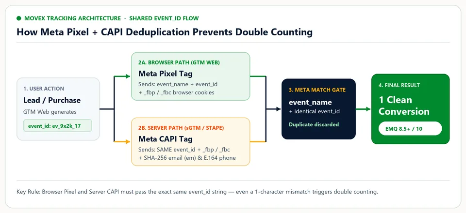

+++
title = "Meta Pixel + CAPI Deduplication in GTM: Fix Duplicate Events and Raise Match Quality"
slug = "meta-pixel-capi-deduplication-event-id-gtm"
author = "Ferdous Wahid Fahim — Founder & Paid Media Strategist"
date = "2026-11-26"
modified = "2026-11-26"
description = "Stop Meta Events Manager from double counting Pixel and Conversions API events in Google Tag Manager using a shared event_id, and push Event Match Quality past 8.5/10."
excerpt = "How to wire one shared event_id across GTM Web and Server-Side CAPI, recover lost _fbc cookies on Safari/iOS, and verify clean deduplication in 5 minutes."
category = "Paid Social & Tracking"
topic = "paid"
read_minutes = 7
image = "assets/blog/meta-pixel-capi-deduplication-cover.webp"
image_alt = "MoveX editorial graphic illustrating Meta Pixel and Conversions API deduplication via a shared event_id in GTM"
tags = ["Meta Ads", "Meta CAPI", "GTM", "Server-Side Tracking", "Event Match Quality"]
status = "published"
+++

You install Meta Conversions API (CAPI) alongside your browser Pixel to recover lost iOS conversions. Two days later, Meta Events Manager flashes a yellow warning: *"Events are not being deduplicated properly"*—and your Ads Manager starts reporting twice as many purchases as Shopify.

When browser and server events fail to deduplicate, Meta's delivery algorithm optimizes on inflated signals. Even worse, if your `_fbc` click ID or hashed customer fields drop along the way, your Event Match Quality (EMQ) sinks to 4.5/10 and your CPA quietly climbs.

> **The core rule of Meta deduplication:** Meta only merges a browser Pixel hit and a server CAPI hit when **both** `event_name` and `event_id` match identically. Even a single extra character or whitespace makes Meta count two separate conversions.

## How clean Meta Pixel + CAPI deduplication works

Before editing tags, look at the signal path below. One user action should generate **one** unique `event_id` in GTM Web, then fan out to both the browser Pixel and your server-side GTM container (such as Stape) carrying the exact same ID.

When both signals reach Meta Events Manager with the same `event_name` and `event_id`, Meta keeps the richer record, discards the duplicate, and credits a single clean conversion.

## Step 1: Generate one shared `event_id` in GTM Web

Never generate one ID inside your browser tag and a second ID inside your server container. The ID must be created once per interaction and reused everywhere.

- **For standard events (`PageView`, `ViewContent`, `AddToCart`, `Lead`):** Install the community **Unique Event ID** variable template in GTM Web (or create a Custom JavaScript variable returning `'ev_' + Math.random().toString(36).slice(2, 12) + '_' + Date.now()`).
- **For `Purchase` events:** Pass your ecommerce platform's unique `transaction_id` (order number) as the `event_id`—or combine `order_id + '_purchase'`—so even page refreshes never create duplicate orders.

## Step 2: Map the exact same `event_id` to both Browser and Server tags

1. Open your **Meta Pixel Tag** in GTM Web and assign your shared variable to the **Event ID** field.
2. Open the **GA4 Event Tag** (or Stape Data Tag) that forwards events from GTM Web to your **GTM Server Container**, and include `event_id` as an event parameter using that exact same variable.
3. Inside your **GTM Server Container**, open the **Meta Conversions API Tag** and confirm its Event ID field reads `{{Event Data - event_id}}`.

> **Common mistake to avoid:** If you use a Custom JavaScript variable that calls `Date.now()` twice on two separate tags, the timestamp can drift by 1 millisecond and break deduplication. Always use a **GTM Event ID template** or read a single `event_id` pushed into the `dataLayer`.

## Step 3: Push Event Match Quality (EMQ) past 8.5 / 10

Deduplication stops over-counting; **Event Match Quality** determines how accurately Meta ties each conversion back to the real ad click. Most accounts sit below 6.0/10 because they miss two things:

- **Forward `_fbp` and `_fbc` cookies explicitly:** `_fbp` is Meta's browser ID cookie, and `_fbc` stores the `fbclid` click parameter from your ad. Make sure your GTM Web container reads both cookies and forwards them to sGTM—losing `_fbc` is the #1 reason match quality drops on Safari and iOS traffic.
- **Normalize customer data before hashing:** Pass lowercase, trimmed email (`em`), strict E.164 phone numbers (`ph`, e.g., `+14155552671`), first/last name (`fn`, `ln`), city, postal code, and country on `Lead` and `Purchase` events. Meta's official sGTM CAPI tag handles SHA-256 hashing automatically once inputs are clean.

## Step 4: Verify cleanly in 5 minutes before scaling spend

1. Open **Meta Events Manager > Test Events** and copy your test code into your sGTM Meta CAPI tag temporarily.
2. Trigger a real test `Lead` or `Purchase` on your site while watching both **GTM Preview** and **Meta Test Events**.
3. Confirm two rows appear for the same action—one labeled **Browser** and one labeled **Server**—with the browser row clearly marked **Deduplicated** and both displaying the exact same `event_id`.
4. Remove the test code, publish both GTM containers, and re-check **Events Manager > Diagnostics** after 24 to 48 hours to confirm duplicate warnings disappear and EMQ climbs toward **8.0–9.5 / 10**.

## Common questions

### How long does Meta keep `event_id` for deduplication?
Meta compares incoming browser and server events sharing the same `event_name` and `event_id` within a 48-hour deduplication window, keeping one record and discarding the duplicate.

### Why is my Event Match Quality low even though CAPI is active?
Sending server events alone is not enough if user parameters are missing. Check that `_fbc`, `_fbp`, lowercase email, and E.164 phone numbers are populated inside your sGTM incoming event data on `Lead` and `Purchase` events.

### Should I turn off the browser Meta Pixel once CAPI is running?
No. Meta recommends running both the browser Pixel and Conversions API together with `event_id` deduplication so you capture full browser context alongside resilient server-side delivery.

## Need a clean Meta CAPI + sGTM setup?

Clean tracking is the fastest way to stabilize Meta CPA before changing creatives or audiences. Explore [MoveX Meta & Instagram Ads](paid-social.html), review our [Analytics & Server-Side Tracking](analytics-tracking.html) service, or read our guide on [fixing GA4 vs. Google Ads conversion double counting](/insights/ga4-google-ads-conversion-mismatch-fix/).
