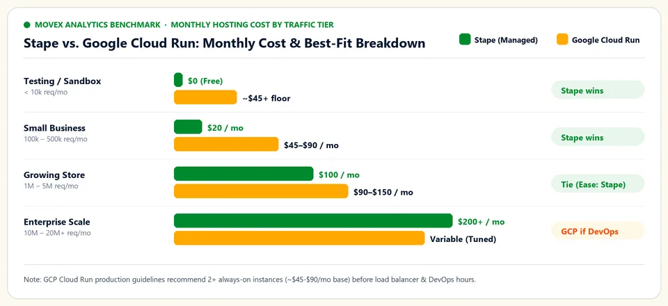

+++
title = "Stape vs. Google Cloud Run for Server-Side GTM: Real Cost & Setup Comparison"
slug = "stape-vs-google-cloud-server-side-gtm-cost"
author = "Ferdous Wahid Fahim — Founder & Paid Media Strategist"
date = "2026-11-27"
modified = "2026-11-27"
description = "Compare Stape.io vs. Google Cloud Run for Server-Side Google Tag Manager (sGTM): real monthly hosting costs by traffic tier, DevOps time, and which host fits your business."
excerpt = "Under 5 million monthly requests, Stape's flat $20-$100/mo pricing beats Google Cloud Run's ~$45-$90/mo production floor and saves hours of DevOps setup. Here is the full breakdown."
category = "Analytics & Server-Side Tracking"
topic = "paid"
read_minutes = 7
image = "assets/blog/stape-vs-gcp-sgtm-cover.webp"
image_alt = "Side-by-side comparison of Stape managed sGTM hosting versus Google Cloud Run self-managed hosting"
tags = ["Server-Side GTM", "Stape", "Google Cloud", "GA4", "Conversion Tracking"]
status = "published"
+++

The moment you decide to move your GA4, Google Ads Enhanced Conversions, or Meta CAPI tracking to **Server-Side Google Tag Manager (sGTM)**, you hit the exact same fork in the road: should you host your container on **Stape** or directly inside **Google Cloud (Cloud Run)**?

On paper, Google Cloud looks cheaper because it bills pay-as-you-go for raw compute. In practice, once you turn on Google's own recommended production settings—two always-on instances, a custom domain, and load balancing—small and mid-sized brands often end up paying **twice as much** on GCP while spending hours maintaining infrastructure.

> **The quick verdict:** If your website sends under **5 million tracking requests per month**, Stape's flat $20 to $100/mo pricing almost always costs less than Google Cloud Run's ~$45–$90/mo production floor—and takes 5 minutes to launch instead of half a day of DevOps.

## Monthly cost breakdown by traffic tier

Stape charges predictable monthly tiers based on request volume (every hit arriving at your server container, including script loads). Google Cloud Run bills for active CPU, memory, network egress, and custom-domain load balancing.

Notice how the gap flips only at enterprise scale. For a typical Shopify store, SaaS site, or lead-generation brand running 100,000 to 500,000 requests per month, Stape's **$20/month Pro Plan** is less than half of Google Cloud Run's baseline production bill.

## Why Google Cloud Run costs more than the calculator suggests

Many marketers assume they can run sGTM on Google Cloud's free tier forever. That works for a 10-minute sandbox test, not for live paid-ad conversion tracking.

- **Minimum production instances:** Google's official sGTM production guide recommends running at least **2 to 3 always-on instances** (around 1 vCPU and 0.5 GB RAM each) to avoid cold starts and dropped conversions during traffic spikes. That alone creates a **~$45 to $90/month floor** before heavy traffic hits.
- **Custom domain & load balancer fees:** Running sGTM on your own first-party subdomain (like `sgtm.yourdomain.com`) is essential for extending Safari/iOS cookie life. On GCP, wiring HTTPS custom domains through a Cloud Load Balancer adds separate monthly line items.
- **Hidden engineering hours:** Setting up GCP revisions, IAM permissions, container updates, and log-retention caps requires DevOps comfort. Even two hours of developer maintenance a quarter wipes out any raw hosting savings.

## Where Stape wins for ecommerce brands and agencies

Stape was built specifically for marketing tracking rather than general cloud engineering, which removes the biggest bottlenecks fast:

- **5-minute launch:** Paste your GTM server container config, add one DNS record for your custom subdomain, and SSL provisions automatically.
- **Marketing-specific power-ups:** Features like **Custom Loader** (which helps recover hits blocked by aggressive ad blockers) and **Cookie Keeper** (extending first-party cookie persistence on Safari/ITP) are built in—no custom middleware required.
- **EU hosting options:** Selecting EU data centers simplifies GDPR architecture without configuring multi-region GCP load balancers manually.

## When Google Cloud Run is actually the smarter choice

Stape is not the right answer for every organization. Choose **Google Cloud Run** if:

1. **You exceed 10M–20M+ monthly requests** and already have an in-house cloud team that can tune autoscaling, CPU allocation, and Cloud Logging costs tightly.
2. **Strict enterprise governance applies:** Regulated healthcare, fintech, or enterprise security teams often require all first-party telemetry to remain strictly inside their own corporate GCP organization with zero third-party sub-processors.

## 60-second decision checklist

- **Under 10k requests (testing):** Stape Free ($0/mo).
- **100k – 500k requests (SMB / Shopify / local service):** Stape Pro ($20/mo).
- **1M – 5M requests (growing ecommerce / B2B):** Stape Business ($100/mo) for speed and zero DevOps.
- **10M+ requests or strict enterprise GCP-only policy:** Google Cloud Run with dedicated engineering ownership.

## Common questions

### Does Stape slow down my website compared to Google Cloud?
No. Both Stape and Google Cloud Run serve sGTM containers asynchronously from regional edge data centers. In fact, serving `gtm.js` from a first-party subdomain on either host often improves script reliability without hurting Core Web Vitals.

### Can I migrate from Stape to Google Cloud (or vice versa) later?
Yes. Because your tags, triggers, and variables live inside your Google Tag Manager Server Container, moving hosts only requires provisioning the new server URL and updating your DNS CNAME/A record—you do not rebuild your GTM setup.

### Do I need server-side GTM if I only spend $2,000/month on ads?
If you run Meta Ads or Google Ads with Enhanced Conversions and see missing iOS/Safari conversions, Stape's $20/month tier usually pays for itself quickly in cleaner attribution and lower CPA.

## Need a clean server-side GTM setup without DevOps headaches?

Explore [MoveX Analytics & Server-Side Tracking](analytics-tracking.html), check our guide on [fixing Meta Pixel + CAPI deduplication in GTM](/insights/meta-pixel-capi-deduplication-event-id-gtm/), or read how to [resolve GA4 vs. Google Ads conversion mismatches](/insights/ga4-google-ads-conversion-mismatch-fix/).
